# 01 — End-to-End Component Architecture

## 1.1 Planes

Guardian-AVIT is organised into five planes. The separation matters: the **Decision Plane must be able
to reach a verdict with the Reasoning Plane completely unavailable** (fail-closed to escalation), and
the **Execution Plane must never be able to write to the Evidence Plane** (agents cannot forge their
own proof).

| Plane | Responsibility | Trust level |
|---|---|---|
| **Telemetry Plane** | Scanner adapters, normalisation, fingerprinting, symbol resolution | Untrusted input, validated |
| **Knowledge Plane** | Universal Symbol Graph, contract registry, invariant registry, runtime evidence | Authoritative, derived deterministically |
| **Reasoning Plane** | Copilot Chat oracle, LLM triage assistants, invariant proposal | **Advisory only — cannot loosen any gate** |
| **Execution Plane** | Agent sandboxes (Devin), build/test runners, ephemeral environments | Hostile-by-assumption, network-egress-controlled |
| **Decision Plane** | Semantic diff, gate pipeline, policy engine, merge orchestration, evidence store | Deterministic, append-only, audited |

## 1.2 Component diagram

```mermaid
flowchart TB
    subgraph SRC["SCANNER TELEMETRY (App ID CCABC)"]
        M5["Mythos 5<br/>semantic / BOLA / race<br/>~1,000 · SLA 7d"]
        CX["Checkmarx<br/>SAST taint<br/>~900 · SLA 30d"]
        BD["BlackDuck<br/>SCA CVE / license<br/>~800 · SLA 30d"]
        PC["Prisma Cloud<br/>container / IaC drift<br/>~300 · SLA 30d"]
    end

    subgraph TP["① TELEMETRY PLANE"]
        AD["Source Adapters<br/>REST · SARIF · CSV/XLSX drop<br/>schema-validated, idempotent"]
        NRM["Normaliser<br/>→ Canonical Vulnerability Record"]
        SYM["Symbol Resolver<br/>path+line ⇒ SCIP symbol ID<br/>commit-pinned"]
        FPR["Fingerprint + Dedup<br/>H(rule_class, symbol, sink, flow_sig)"]
        AD --> NRM --> SYM --> FPR
    end

    subgraph KP["② KNOWLEDGE PLANE"]
        USG[("Universal Symbol Graph<br/>18+ components · nodes: Component,<br/>Type, Method, Endpoint, Topic, Table<br/>edges: CALLS, EXPOSES, PUBLISHES,<br/>PROTECTED_BY, DEPENDS_ON")]
        CR[("Contract Registry<br/>OpenAPI · Protobuf · Avro<br/>Pact · SQL DDL")]
        IR[("Invariant Registry<br/>High-Invariance Zones<br/>versioned, human-ratified")]
        RT[("Runtime Evidence<br/>OTel traces · prod coverage<br/>90-day symbol execution map")]
        IDX["Polyglot Indexers<br/>Java · Kotlin · C# · TS · Py · JS<br/>(SCIP emitters + CodeQL DBs)"]
        IDX --> USG
        CR --> USG
        RT --> USG
    end

    subgraph TRI["③ TRIAGE & REACHABILITY"]
        RCH["Reachability Engine<br/>T0 provenance → T1 static<br/>→ T2 config/contract → T3 runtime<br/>→ T4 exploitability"]
        VFP["VFP Closer<br/>evidence bundle + TTL<br/>+ premise-drift watch"]
        COR["Correlation Engine<br/>N findings ⇒ 1 fix-unit<br/>cross-scanner on shared symbol"]
        SLA["Lane Scheduler<br/>A: 7d · B: 30d · C: dep trains<br/>WIP limits, capacity pools"]
        RCH --> VFP
        RCH --> COR --> SLA
    end

    subgraph RP["④ REASONING PLANE (advisory)"]
        CCO["Copilot Chat Oracle<br/>· invariant extraction<br/>· business-vs-flaw intent<br/>· pre-merge intent review"]
        GRD["Grounding Filter<br/>citation check · schema constraint<br/>3-vote self-consistency · hash-logged"]
        RAT["Human Ratification<br/>invariant PR review"]
        CCO --> GRD --> RAT --> IR
    end

    subgraph PLN["⑤ PLANNING"]
        CLU["Topological Clusterer<br/>conflict graph → communities<br/>→ constrained bin-pack → 40–70 PRs"]
        BRS["Blast Radius Scorer<br/>0–100 · centrality, consumers,<br/>HIZ proximity, contract exposure"]
        EFF["Effort + Regression Mapper<br/>test-impact selection<br/>agent difficulty tier"]
        CLU --> BRS --> EFF
    end

    subgraph LOCK["⑥ BEHAVIOURAL LOCKING"]
        CHR["Characterization Recorder<br/>golden master: HTTP pairs,<br/>negative-auth matrix, Kafka events,<br/>DB deltas, txn spans, latency"]
        EXD["Expected-Delta Declaration<br/>the ONLY permitted behaviour change"]
        CHR --> EXD
    end

    subgraph EX["⑦ EXECUTION PLANE (hostile-by-assumption)"]
        RC["Remediation Contract<br/>scoped surface · forbidden ops<br/>invariants · acceptance criteria"]
        DEV["Devin / coding agent<br/>sandboxed worktree<br/>egress-allowlisted, budgeted"]
        RC --> DEV
    end

    subgraph DP["⑧ DECISION PLANE (deterministic)"]
        SD["Semantic Diff Engine<br/>AST + graph delta<br/>~40 anti-cheat detectors"]
        G["Gate Pipeline G0–G8"]
        POL["Policy Engine (OPA/Rego)<br/>triage matrix → verdict"]
        MRG["Merge Orchestrator<br/>symbol leases · merge trains<br/>canary + auto-revert"]
        SD --> G --> POL --> MRG
    end

    EVD[("Evidence Store (WORM)<br/>every scan, query, prompt hash,<br/>patch, gate artefact, verdict")]

    SRC --> AD
    FPR --> RCH
    USG --> RCH
    CR --> RCH
    RT --> RCH
    SLA --> CLU
    USG --> BRS
    IR --> BRS
    COR --> CCO
    USG --> CCO
    CR --> CCO
    EFF --> CHR
    IR --> RC
    EFF --> RC
    EXD --> RC
    DEV -- "patch bundle + rationale" --> SD
    IR --> SD
    EXD --> G
    POL -- "REJECT_AND_REISSUE + structured rejection" --> RC
    POL -- "escalate" --> HUM["Security Architect /<br/>Component Owner queue"]
    MRG --> REPO[("GitHub Enterprise<br/>18+ repositories")]
    VFP --> EVD
    G --> EVD
    CCO --> EVD
    MRG --> EVD

    classDef advisory stroke-dasharray: 5 5
    class RP,CCO,GRD advisory
```



> **Reading the dashed boundary:** everything inside the Reasoning Plane is advisory. Its outputs enter
> the system only as (a) *proposals* that a human ratifies into the Invariant Registry, or (b) *risk
> signals* that can raise an escalation tier. There is no edge from the Reasoning Plane to a
> merge-permitting decision.

## 1.3 Request-level runtime flow (ASCII, for the 7-day lane)

```
 t0        AVIT lands (Mythos webhook / nightly CSV drop)
  │
  ├─► [Adapter] validate ─► [Normaliser] CVR ─► [Symbol Resolver] SCIP id @commit
  │                                                        │
  │                                  ┌─────────────────────┴─────────────────────┐
  │                                  ▼                                           ▼
  ├─► [Reachability T1..T4]  ── UNREACHABLE ─► [VFP Closer] evidence bundle ─► CLOSED(VFP)
  │            │                                                    │  TTL 90d, drift-watch armed
  │        REACHABLE                                                └─► re-open on premise change
  │            ▼
  ├─► [Correlation] group with Checkmarx CX-441902 (same symbol) ─► fix-unit FU-…
  │            ▼
  ├─► [Copilot Oracle] invariant extraction ─► [Grounding] ─► [Human ratify] ─► Invariant Registry
  │            ▼
  ├─► [Clusterer] batch PR-CCABC-017   [BRS] 68/100 HIGH   [Effort] T3   [Tests] 4 suites
  │            ▼
  ├─► [Characterization Recorder] 42 golden cases pinned + expected_delta declared
  │            ▼
  ├─► [Contract Builder] emit RemediationTask v1 ─► [Devin sandbox]  (budget: 90 min, 3 iterations)
  │            ▼
  ├─► patch bundle ─► [Semantic Diff] ─► G0…G8 ─► [Policy] verdict
  │            │                                       │
  │            │                                       ├─ MERGE_AUTONOMOUS ──► merge train ─► canary
  │            │                                       ├─ PEER_REVIEW ───────► CODEOWNERS
  │            │                                       ├─ SECURITY_ARCHITECT ► AppSec queue + evidence
  │            │                                       ├─ REJECT_AND_REISSUE ► back to Devin (attempt++)
  │            │                                       └─ HUMAN_FIX ─────────► engineer, agent stands down
  │            ▼
 t≤7d    merged, canary SLO-watched 24h, auto-revert armed, scanner re-verified on main
```

## 1.4 Data stores and why each one

| Store | Technology | Holds | Why this and not the others |
|---|---|---|---|
| Canonical store | PostgreSQL 16 | CVRs, fix-units, contracts, verdicts, lane state | Needs multi-row transactional integrity (a verdict + lease + state transition must commit atomically) and rich relational queries. |
| Graph store | Neo4j (or Memgraph / Postgres+AGE) | Universal Symbol Graph, ~10⁷ nodes / ~10⁸ edges for 18 components | Reachability, centrality and blast-radius are variable-depth traversals. Expressing "all ingress paths to symbol X across component boundaries" in SQL recursive CTEs is possible but operationally miserable at this depth. |
| Event bus | Kafka | Pipeline stage transitions, scan ingest, gate events | Already the enterprise substrate; gives replay for reprocessing the whole backlog after a ruleset change. |
| Workflow engine | Temporal | Long-running remediation workflows (days, with human steps) | A 7-day SLA workflow with sandbox timeouts, human approval waits and compensation on revert is exactly Temporal's shape. Cron + queue tables will rot. |
| Lease/coordination | Redis | Symbol/file write leases, agent dispatch rate limits | D7 concurrency control needs sub-second TTL leases with fencing tokens. |
| Artefact + evidence | S3 (Object Lock / WORM) | SARIF, evidence bundles, golden-master recordings, patch bundles, prompt+response hashes | Compliance requires the evidence for an auto-closed VFP or an autonomous merge to be immutable and reproducible years later. |
| Search | OpenSearch | Audit and analyst search over evidence | Analysts need "show me every VFP closed by ruleset v4.2 in `account-service`". |
| Secret/identity | Vault + GitHub App installation tokens | Short-lived, per-contract, per-repo scoped credentials | Agents get repo-scoped, 90-minute, single-repo tokens — not a PAT with org write. |

## 1.5 Sandbox and blast-containment for the Execution Plane

The agent is treated as hostile-but-useful. Concretely:

- **Worktree scoping.** The sandbox is seeded with a sparse checkout containing only the paths in
  `change_surface.allow` plus read-only context paths. `SecurityConfig.java` is simply absent unless
  the contract names it.
- **Immutable regions.** Characterization tests and invariant files are mounted read-only; the
  pre-commit hook in the sandbox rejects writes, and G0 re-verifies by hash regardless.
- **Egress allowlist.** Package registries (proxied, versions pinned to the contract's dependency
  allowlist) and the Copilot/agent control plane only. No arbitrary internet, no prod networks.
- **Credential scoping.** GitHub App token limited to the single repo, `contents:write` on a branch
  namespace `guardian/<contract_id>/*`, no `workflows:write` (an agent must not be able to edit CI).
- **Budgets.** Wall-clock, token, iteration-count and tool-call ceilings; exceeding any produces a
  `BLOCKED` outcome, not a partial patch.
- **No evidence write path.** The sandbox cannot reach the Evidence Store or the Postgres canonical
  store; it emits a patch bundle to a quarantine bucket that the Decision Plane pulls from.

## 1.6 Where each open question is answered

| Directive question | Answer |
|---|---|
| A — bifurcate or unify | [02](02-pipeline-tradeoff.md) — unified spine, bifurcated lanes |
| B — role of Copilot Chat | [05](05-copilot-chat-oracle.md) — advisory oracle with grounding filter and ratification |
| C — polyglot governance | [06](06-polyglot-governance.md) — SCIP identity + LanguageAdapter contract + capability degradation |
